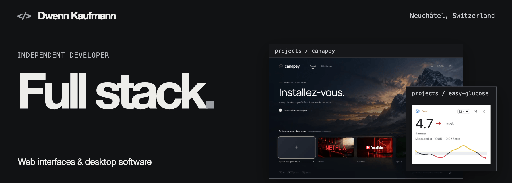

I’m Dwenn, an independent developer in Neuchâtel, Switzerland. I design interfaces and write the code behind them, from the database in a phone repair shop to the controller navigation on my living room PC.

[Explore my portfolio ↗](https://dwenn.ch/en/work/)

## Things I’ve built

### [Canapey Launcher](https://github.com/DwennK/canapey-launcher)

I wanted to launch games on my living room PC with the controller already in my hands. I built a launcher with big artwork and a selection you can follow from across the room. Vue handles navigation, and Rust starts the apps and tracks each Windows session. [See the interface ↗](https://dwenn.ch/en/work/canapey/)

### [POS Téléphonie](https://github.com/DwennK/004-Nuxt)

A phone can be ready for pickup while its invoice is still unpaid. I built a repair shop app around that distinction. Staff can follow a device from check-in to pickup, record payments and manage stock. I designed the screens, the server APIs and the data model. [Inside a repair case ↗](https://dwenn.ch/en/work/pos-telephonie/)

### [Easy Salaires](https://github.com/DwennK/Easy-Salaires)

I built a free payroll app for small Swiss businesses. You can review twelve months of pay on one screen, open a month to issue a PDF payslip and look up an earlier revision later. Each company’s records live in a local SQLite database on Mac or Windows. [See the payroll workflow ↗](https://dwenn.ch/en/work/easy-salaires/)

### [Easy Glucose](https://github.com/DwennK/Easy-Glucose)

I wanted a glucose reading to fit in the Mac menu bar. The app also has a floating widget and a chart on Mac and Windows. I wrote the interface in Rust with egui. When the sensor skips a reading, the chart leaves a gap so you can see exactly where the data stops. [See the widget ↗](https://dwenn.ch/en/work/easy-glucose/)

### [Tasks](https://github.com/DwennK/Tasks)

I built a Mac task manager that I can use from a window or a shell. The app, CLI and MCP server work with the same tasks, so I can capture something in the terminal and pick it up later in the app. The app stores its data in SQLite on my Mac.

## My stack

| Where I use it | Tools |
| :--- | :--- |
| Web interfaces | Vue · Nuxt · Astro · TypeScript · GSAP |
| Desktop apps | Rust · Tauri · egui · SQLite |
| APIs & data | Cloudflare Workers · Drizzle · Turso / libSQL |
| Commerce | Shopify · WooCommerce · WordPress |
| Testing & delivery | Playwright · GitHub Actions |
